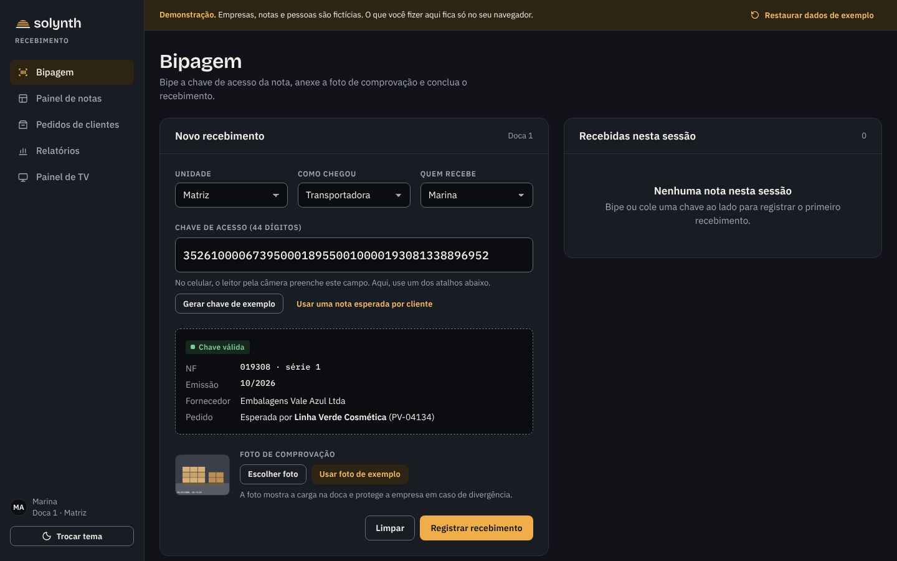
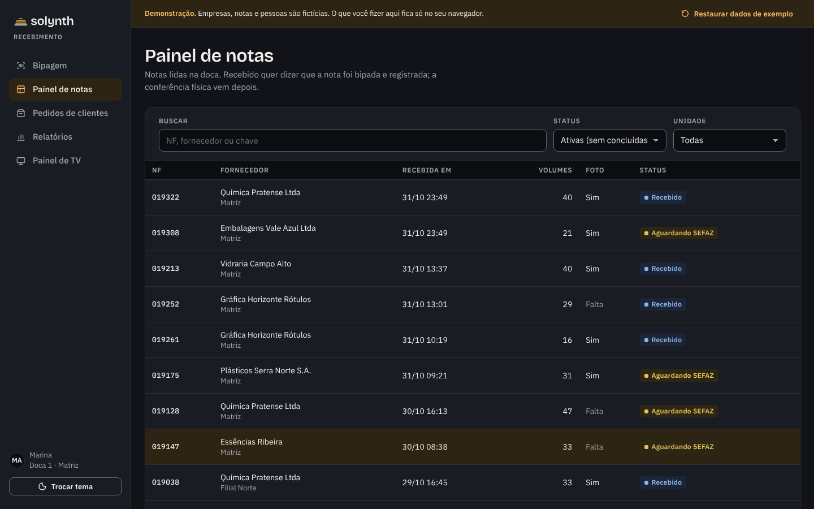
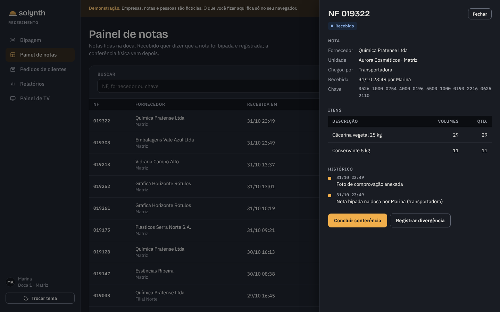
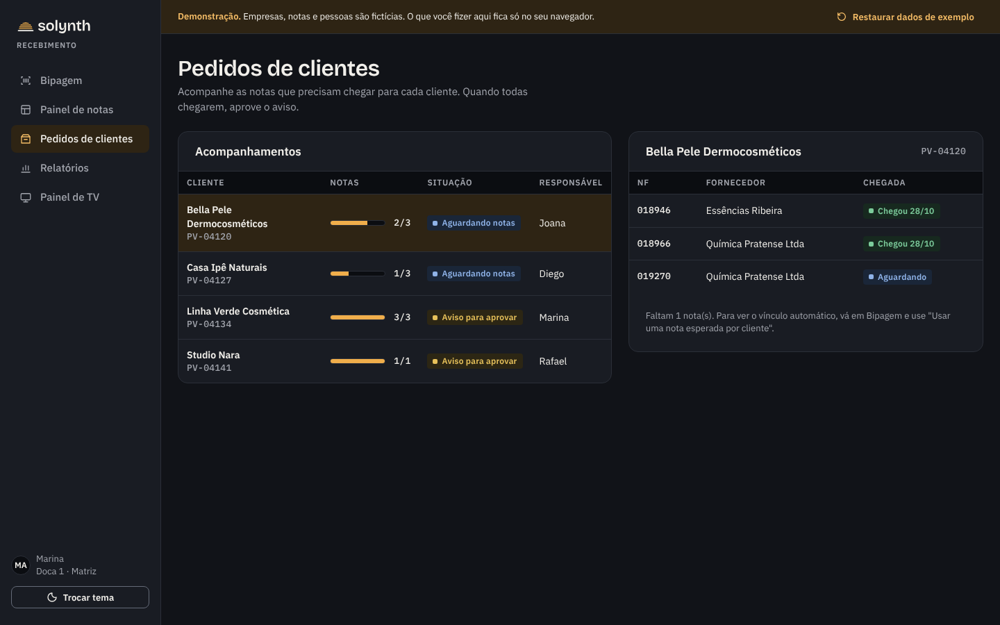
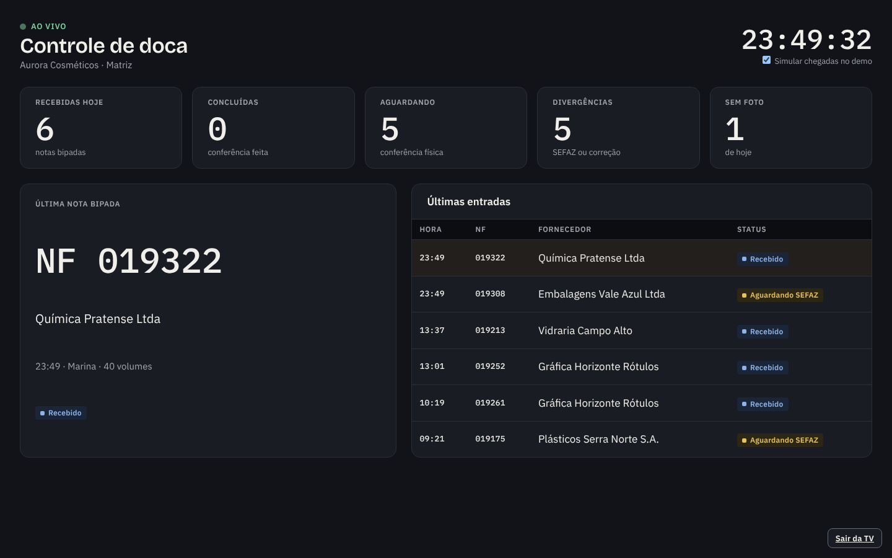
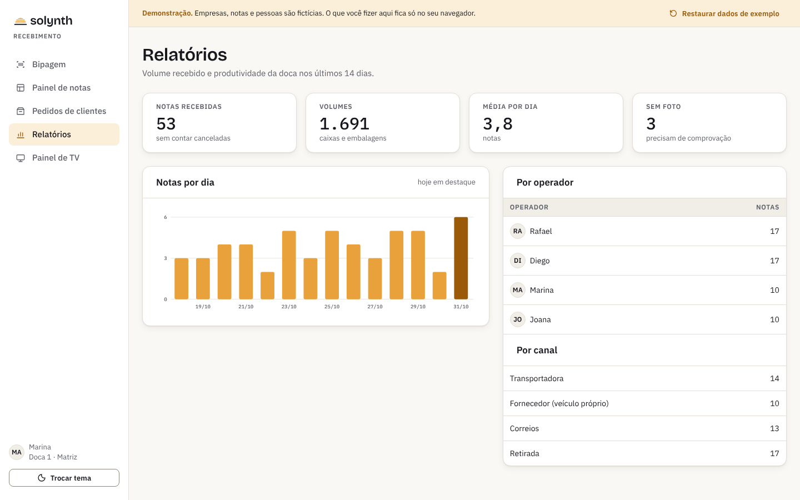

<p align="center">
  <picture>
    <source media="(prefers-color-scheme: dark)" srcset="assets/solynth-lockup-dark.svg">
    
  </picture>
</p>

<p align="center"><a href="README.md">Português</a> · <b>English</b> · <a href="README.es.md">Español</a></p>

<h1 align="center">Recebimento</h1>

<p align="center">Goods-receiving control for a factory dock: invoice scanning, proof of delivery, inspection and customer notices.</p>

<p align="center">
  <a href="https://lucasjpl1.github.io/solynth-recebimento/"></a>
</p>

<p align="center">
  <a href="https://lucasjpl1.github.io/solynth-recebimento/"></a>
</p>

> **Demo with fictitious data.** Companies, suppliers, customers, people and access keys are made up. The demo runs entirely in the browser and sends nothing anywhere. The interface is in Brazilian Portuguese, the language of the operation it was built for.

---

## The problem

At a factory dock, the invoice arrives together with the cargo and has to become information right away: who received it, when, in what condition, and whether it matches what was ordered. When that lives on paper and spreadsheets, inspection is delayed, customers don't know their material has arrived, and nobody can prove what happened if there is a discrepancy.

In Brazil every shipment travels with an electronic invoice (NF-e) identified by a 44-digit access key, and its authorization is checked against the state tax authority (SEFAZ). The system is built around that key.

## What Recebimento does

| Screen | Purpose |
|---|---|
| **Bipagem** (scanning) | The operator scans the access key printed on the invoice (44 digits, with check-digit validation), attaches a photo of the cargo and records the receipt. If a customer was expecting that invoice, the link is made on the spot. |
| **Painel de notas** (invoice board) | Every invoice with its status: received, awaiting SEFAZ, awaiting correction, completed, cancelled. Each one has its items, key and full history. |
| **Pedidos de clientes** (customer orders) | Tracks the invoices each customer is waiting for. When all of them arrive, the notice is ready to approve. |
| **Relatórios** (reports) | Invoices per day, volumes, productivity per operator and per delivery channel. |
| **Painel de TV** (TV board) | A live view of the dock for a wall monitor: received, pending, last invoice and latest entries. |

## Screens

<table>
<tr>
<td width="50%"><br><sub><b>Invoice board</b> · status, photo and volumes for each invoice</sub></td>
<td width="50%"><br><sub><b>Invoice detail</b> · items, key and full history</sub></td>
</tr>
<tr>
<td width="50%"><br><sub><b>Customer orders</b> · notice ready once every invoice has arrived</sub></td>
<td width="50%"><br><sub><b>TV board</b> · live view for the dock monitor</sub></td>
</tr>
<tr>
<td width="50%"><br><sub><b>Reports</b> · light theme, for the office</sub></td>
<td width="50%" valign="middle"><sub>Operational screens open in the <b>dark theme</b>, designed for long shifts and reading from a distance. The <b>Trocar tema</b> button switches to light.</sub></td>
</tr>
</table>

## Try it

1. On **Bipagem**, click **Gerar chave de exemplo** (generate a sample key) or **Usar uma nota esperada por cliente** (use an invoice a customer is expecting).
2. Click **Usar foto de exemplo** (use sample photo), then **Registrar recebimento** (record receipt).
3. Open **Painel de notas**, click the invoice and complete the inspection or record a discrepancy.
4. On **Pedidos de clientes**, see the notice ready to approve.
5. Open **Painel de TV** and leave it on: the demo simulates a new arrival every 15 seconds.

**Restaurar dados de exemplo**, in the top bar, resets everything to the initial scenario.

## About this repository

This is the **browsable demo** of a system I built that runs in production: plain HTML, CSS and JavaScript, no build step and no backend, published on GitHub Pages. It shows the flow and the interface.

The real system is built with Node.js, Express and PostgreSQL. It includes role-based access, an audit trail, invoice lookup and acknowledgment with SEFAZ, email notices, document custody, the TV board and a notification bot. That code is not public and the system is not for sale; this repository exists as a portfolio piece.

```
index.html     application shell
css/app.css    Solynth design system tokens and components
js/data.js     fictitious scenario generator (fixed seed)
js/app.js      screens, navigation and demo rules
assets/        Solynth logos
docs/telas/    screenshots used in this README
```

To run it locally, open `index.html` or serve the folder with any static server.

## License

Source available for viewing only. **All rights reserved**: copying, redistributing or using the code, the Solynth name or brand requires permission. See [LICENSE](LICENSE) (in Portuguese) and third-party components in [THIRD-PARTY-NOTICES.md](THIRD-PARTY-NOTICES.md).

---

<p align="center"><sub>Solynth · systems for operations that need a trail</sub></p>
