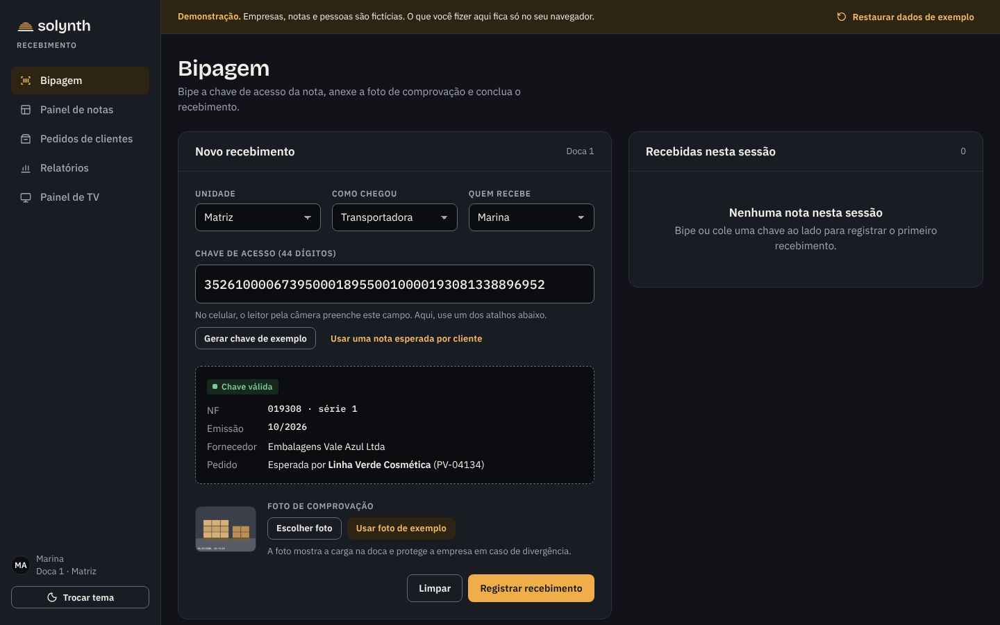
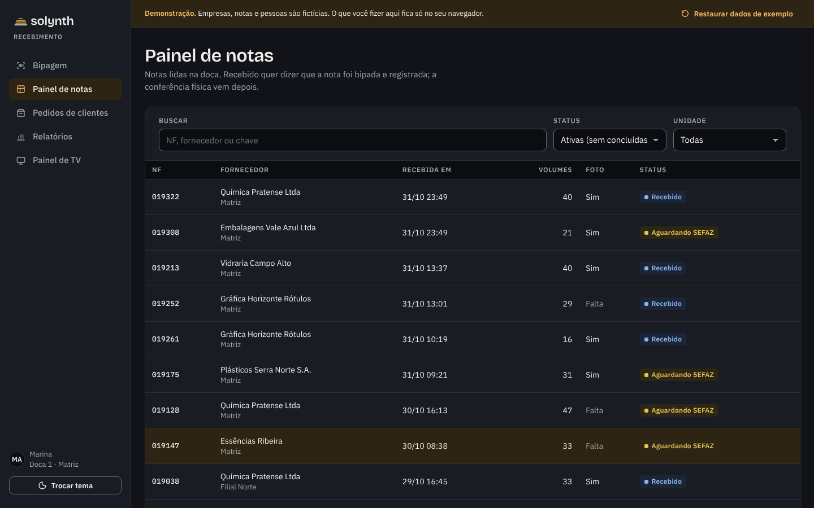
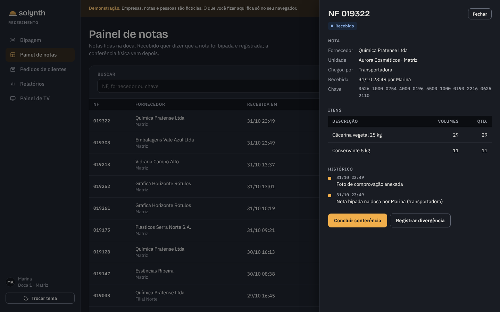
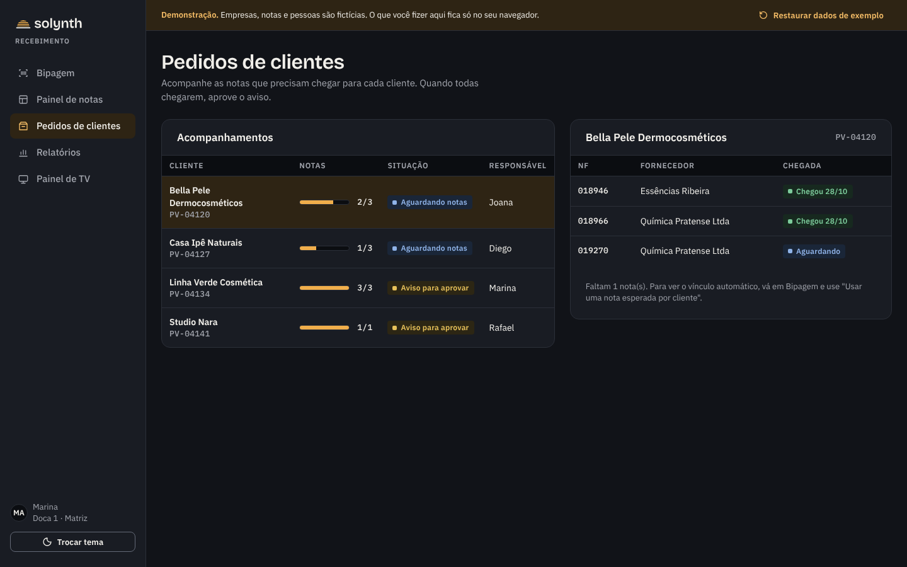
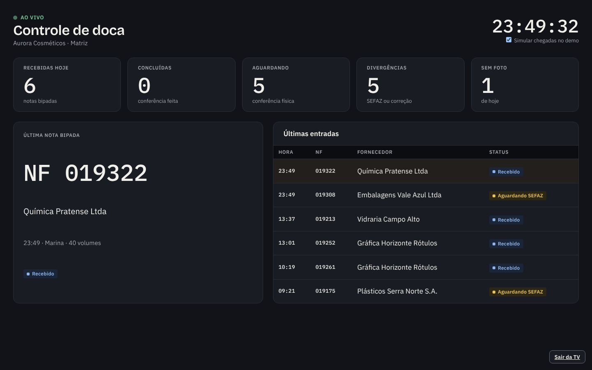
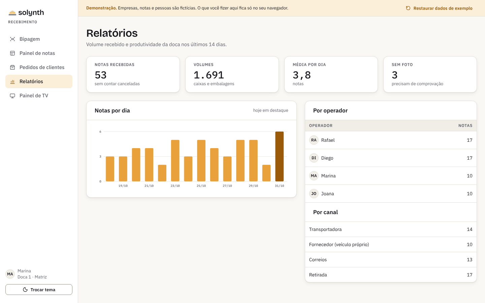

<p align="center">
  <picture>
    <source media="(prefers-color-scheme: dark)" srcset="assets/solynth-lockup-dark.svg">
    
  </picture>
</p>

<p align="center"><a href="README.md">Português</a> · <a href="README.en.md">English</a> · <b>Español</b></p>

<h1 align="center">Recebimento</h1>

<p align="center">Control de la recepción de mercancía en el muelle de una fábrica: escaneo de facturas, comprobación, inspección y aviso al cliente.</p>

<p align="center">
  <a href="https://lucasjpl1.github.io/solynth-recebimento/"></a>
</p>

<p align="center">
  <a href="https://lucasjpl1.github.io/solynth-recebimento/"></a>
</p>

> **Demo con datos ficticios.** Empresas, proveedores, clientes, personas y claves de acceso son inventados. La demo funciona por completo en el navegador y no envía nada a ningún lugar. La interfaz está en portugués de Brasil, el idioma de la operación para la que fue creada.

---

## El problema

En el muelle de una fábrica, la factura llega junto con la carga y tiene que convertirse en información en el momento: quién la recibió, cuándo, en qué estado y si coincide con lo que se pidió. Cuando eso depende de papel y planillas, la inspección se atrasa, el cliente no sabe que su material llegó y nadie puede demostrar qué pasó si hay una diferencia.

En Brasil cada envío viaja con una factura electrónica (NF-e) identificada por una clave de acceso de 44 dígitos, cuya autorización se consulta ante la autoridad tributaria estatal (SEFAZ). El sistema está construido alrededor de esa clave.

## Qué hace Recebimento

| Pantalla | Para qué |
|---|---|
| **Bipagem** (escaneo) | El operador escanea la clave de acceso impresa en la factura (44 dígitos, con validación del dígito verificador), adjunta una foto de la carga y registra la recepción. Si un cliente esperaba esa factura, el vínculo se hace en el momento. |
| **Painel de notas** (panel de facturas) | Todas las facturas con su estado: recibida, esperando SEFAZ, esperando corrección, concluida, cancelada. Cada una tiene ítems, clave e historial completo. |
| **Pedidos de clientes** | Sigue las facturas que cada cliente está esperando. Cuando llegan todas, el aviso queda listo para aprobar. |
| **Relatórios** (informes) | Facturas por día, volúmenes, productividad por operador y por canal de entrega. |
| **Painel de TV** | Vista en vivo del muelle para un monitor: recibidas, pendientes, última factura y últimas entradas. |

## Pantallas

<table>
<tr>
<td width="50%"><br><sub><b>Panel de facturas</b> · estado, foto y volúmenes de cada factura</sub></td>
<td width="50%"><br><sub><b>Detalle de la factura</b> · ítems, clave e historial completo</sub></td>
</tr>
<tr>
<td width="50%"><br><sub><b>Pedidos de clientes</b> · aviso listo cuando llegan todas las facturas</sub></td>
<td width="50%"><br><sub><b>Panel de TV</b> · vista en vivo para el monitor del muelle</sub></td>
</tr>
<tr>
<td width="50%"><br><sub><b>Informes</b> · tema claro, para la oficina</sub></td>
<td width="50%" valign="middle"><sub>Las pantallas de operación abren en <b>tema oscuro</b>, pensado para jornadas largas y lectura a distancia. El botón <b>Trocar tema</b> cambia al claro.</sub></td>
</tr>
</table>

## Cómo probarla

1. En **Bipagem**, haz clic en **Gerar chave de exemplo** (generar clave de ejemplo) o **Usar uma nota esperada por cliente** (usar una factura que un cliente espera).
2. Haz clic en **Usar foto de exemplo** y luego en **Registrar recebimento** (registrar recepción).
3. Abre **Painel de notas**, haz clic en la factura y concluye la inspección o registra una diferencia.
4. En **Pedidos de clientes**, mira el aviso listo para aprobar.
5. Abre **Painel de TV** y déjalo abierto: la demo simula una nueva llegada cada 15 segundos.

**Restaurar dados de exemplo**, en la barra superior, vuelve todo al escenario inicial.

## Sobre este repositorio

Esta es la **demo navegable** de un sistema que desarrollé y que funciona en producción: HTML, CSS y JavaScript puro, sin compilación y sin backend, publicada en GitHub Pages. Muestra el flujo y la interfaz.

El sistema real está construido con Node.js, Express y PostgreSQL. Incluye control de acceso por perfil, registro de auditoría, consulta y manifestación de facturas ante la SEFAZ, avisos por correo electrónico, custodia de documentos, el panel de TV y un bot de notificaciones. Ese código no es público y el sistema no está a la venta; este repositorio existe como portafolio.

```
index.html     estructura de la aplicación
css/app.css    tokens y componentes del design system Solynth
js/data.js     generador del escenario ficticio (semilla fija)
js/app.js      pantallas, navegación y reglas de la demo
assets/        logos Solynth
docs/telas/    capturas usadas en este README
```

Para ejecutarla localmente, abre `index.html` o sirve la carpeta con cualquier servidor estático.

## Licencia

Código disponible solo para visualización. **Todos los derechos reservados**: copiar, redistribuir o usar el código, el nombre o la marca Solynth requiere autorización. Consulta [LICENSE](LICENSE) (en portugués) y los componentes de terceros en [THIRD-PARTY-NOTICES.md](THIRD-PARTY-NOTICES.md).

---

<p align="center"><sub>Solynth · sistemas para operaciones que necesitan trazabilidad</sub></p>
