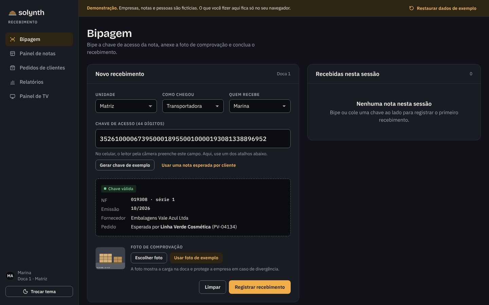
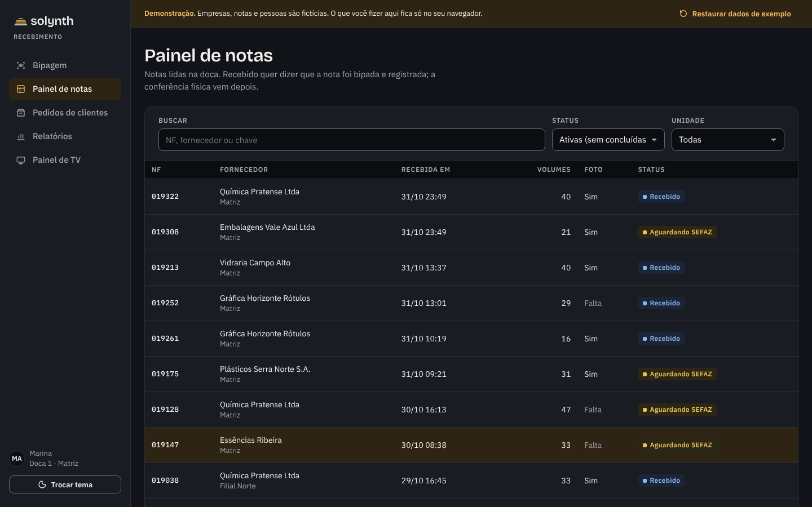
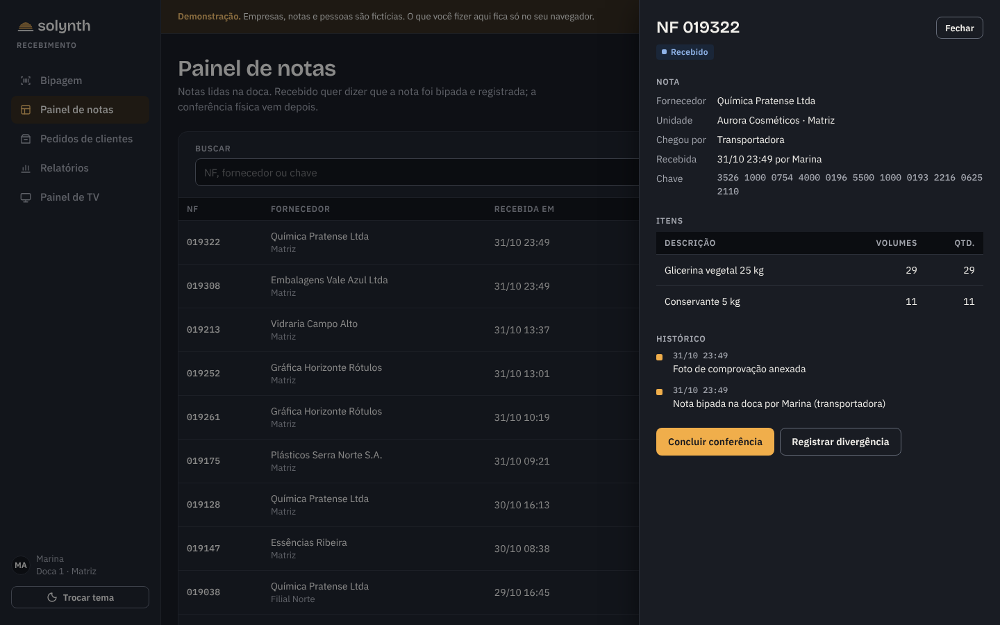
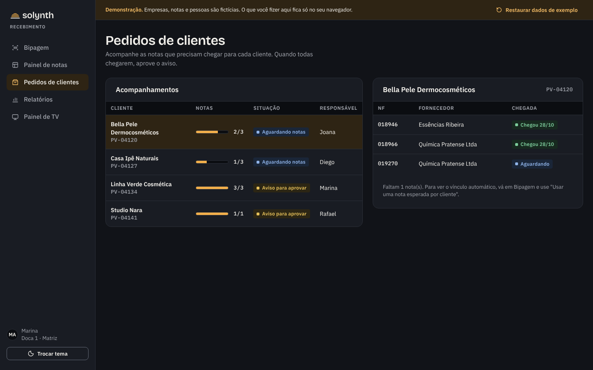
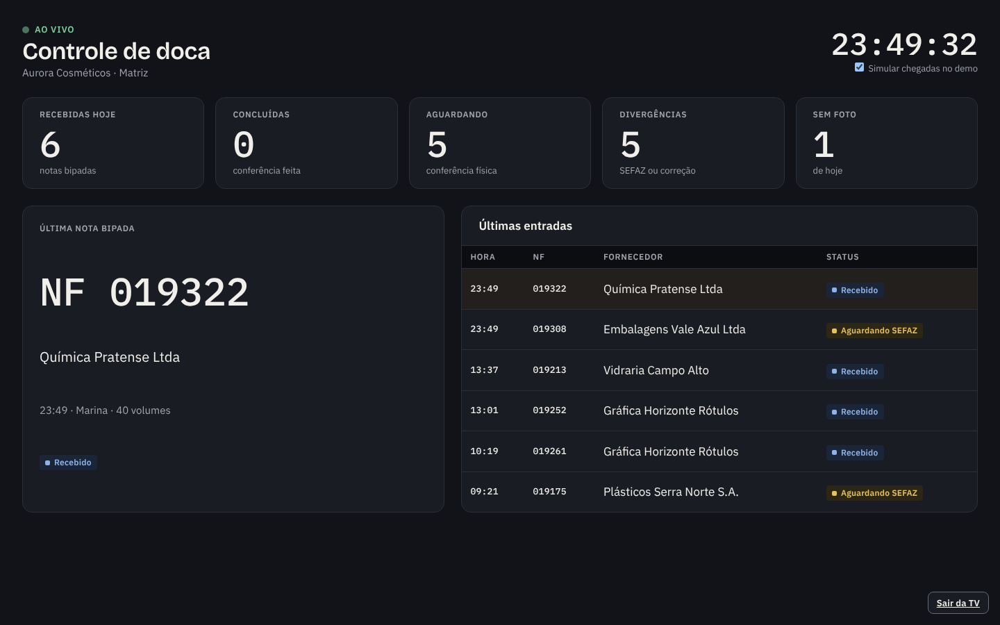
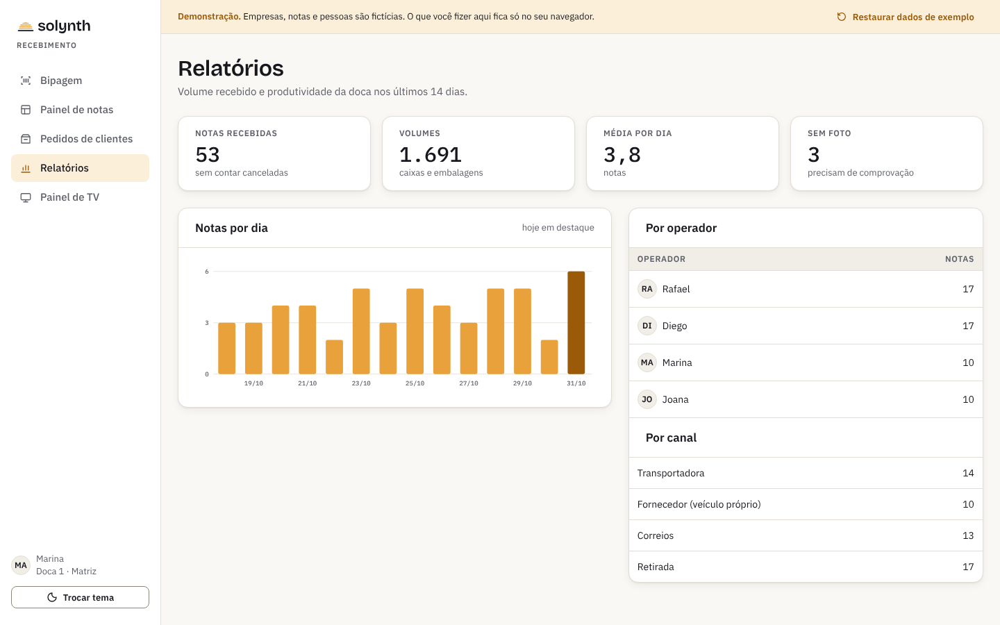

<p align="center">
  <picture>
    <source media="(prefers-color-scheme: dark)" srcset="assets/solynth-lockup-dark.svg">
    
  </picture>
</p>

<p align="center"><b>Português</b> · <a href="README.en.md">English</a> · <a href="README.es.md">Español</a></p>

<h1 align="center">Recebimento</h1>

<p align="center">Controle da chegada de notas fiscais na doca: bipagem, comprovação, conferência e aviso ao cliente.</p>

<p align="center">
  <a href="https://lucasjpl1.github.io/solynth-recebimento/"></a>
</p>

<p align="center">
  <a href="https://lucasjpl1.github.io/solynth-recebimento/"></a>
</p>

> **Demonstração com dados fictícios.** Empresas, fornecedores, clientes, pessoas e chaves de acesso foram inventados. O demo roda inteiro no navegador e não envia nada para lugar nenhum.

<!-- 🎬 VÍDEO: arraste o .mp4 gravado do demo para cá pelo editor do GitHub -->

---

## O problema

Na doca de uma indústria, a nota chega junto com a carga e precisa virar informação na hora: quem recebeu, quando, em que estado, e se a nota bate com o que foi pedido. Quando isso vive em papel e planilha, a conferência atrasa, o cliente não sabe que o material dele chegou e ninguém consegue provar o que aconteceu em caso de divergência.

## O que o Recebimento faz

| Tela | Para quê |
|---|---|
| **Bipagem** | O operador bipa a chave de acesso do DANFE (44 dígitos, com validação do dígito verificador), anexa a foto da carga e registra o recebimento. Se a nota era esperada por um cliente, o vínculo é feito na hora. |
| **Painel de notas** | Todas as notas com status: recebido, aguardando SEFAZ, aguardando correção, concluído, cancelada. Cada nota tem itens, chave e histórico completo. |
| **Pedidos de clientes** | Acompanha as notas que precisam chegar para cada cliente. Quando todas chegam, o aviso fica pronto para aprovar. |
| **Relatórios** | Notas por dia, volumes, produtividade por operador e por canal de entrega. |
| **Painel de TV** | Visão ao vivo da doca para monitor: recebidas, pendências, última nota e últimas entradas. |

## Telas

<table>
<tr>
<td width="50%"><br><sub><b>Painel de notas</b> · status, foto e volumes de cada nota</sub></td>
<td width="50%"><br><sub><b>Detalhe da nota</b> · itens, chave e histórico completo</sub></td>
</tr>
<tr>
<td width="50%"><br><sub><b>Pedidos de clientes</b> · aviso pronto quando todas as notas chegam</sub></td>
<td width="50%"><br><sub><b>Painel de TV</b> · visão ao vivo para o monitor da doca</sub></td>
</tr>
<tr>
<td width="50%"><br><sub><b>Relatórios</b> · tema claro, para o escritório</sub></td>
<td width="50%" valign="middle"><sub>As telas de operação abrem no <b>tema escuro</b>, pensado para uso contínuo e leitura de longe. O botão <b>Trocar tema</b> alterna para o claro.</sub></td>
</tr>
</table>

## Como experimentar

1. Em **Bipagem**, clique em **Gerar chave de exemplo** ou **Usar uma nota esperada por cliente**.
2. Clique em **Usar foto de exemplo** e depois em **Registrar recebimento**.
3. Abra o **Painel de notas**, clique na nota e conclua a conferência ou registre uma divergência.
4. Em **Pedidos de clientes**, veja o aviso pronto para aprovar.
5. Abra o **Painel de TV** e deixe aberto: o demo simula novas chegadas a cada 15 segundos.

**Restaurar dados de exemplo**, na faixa do topo, volta tudo ao cenário inicial.

## Sobre este repositório

Este é o **demo navegável** de um sistema que desenvolvi e que roda em produção: HTML, CSS e JavaScript puro, sem build e sem backend, publicado no GitHub Pages. Ele mostra o fluxo e a interface.

O sistema real foi construído com Node.js, Express e PostgreSQL. Ele inclui controle de acesso por perfil, trilha de auditoria, consulta e manifestação de notas na SEFAZ, avisos por e-mail, custódia de documentos, painel para TV e bot de notificações. Esse código não é público, e o sistema não está à venda; este repositório existe como portfólio.

```
index.html     casco da aplicação
css/app.css    tokens e componentes do design system Solynth
js/data.js     gerador do cenário fictício (semente fixa)
js/app.js      telas, navegação e regras do demo
assets/        logos Solynth
docs/telas/    capturas usadas neste README
```

Para rodar localmente, basta abrir o `index.html` ou servir a pasta com qualquer servidor estático.

## Licença

Código-fonte disponível apenas para visualização. **Todos os direitos reservados**: copiar, redistribuir ou usar o código, o nome ou a marca Solynth exige autorização. Veja [LICENSE](LICENSE) e os componentes de terceiros em [THIRD-PARTY-NOTICES.md](THIRD-PARTY-NOTICES.md).

---

<p align="center"><sub>Solynth · sistemas para operações que precisam de rastro</sub></p>
